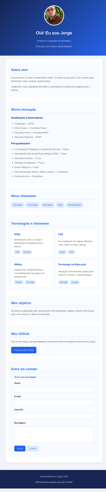
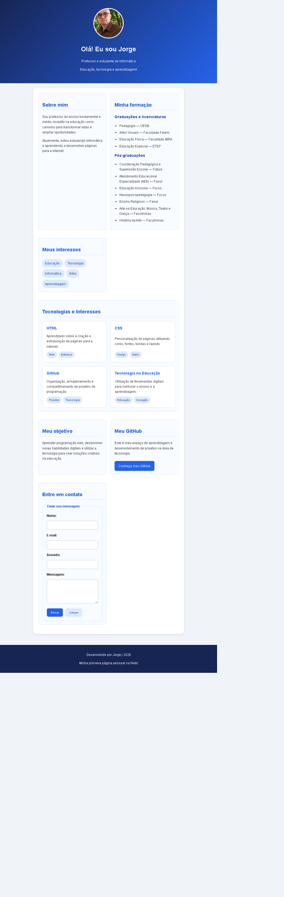
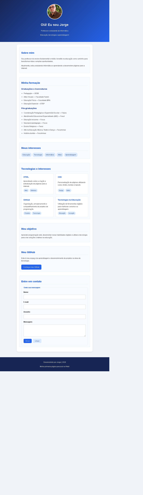
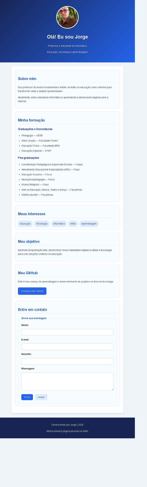

---
---

# Nova atividade – Design Responsivo

Nesta atividade, a página pessoal foi aprimorada para se adaptar a diferentes tamanhos de tela, como computadores, tablets e smartphones.

## Alterações realizadas

- Utilização de unidades relativas, como rem, %, e vw.
- Aplicação de Media Queries para diferentes tamanhos de tela.
- Adaptação do layout para celulares e tablets.
- Organização dos elementos utilizando Flexbox.
- Organização da estrutura da página utilizando CSS Grid Layout.
- Ajustes nos cartões, textos, imagens e formulários para melhorar a visualização em diferentes dispositivos.
- Melhorias na responsividade e na navegação da página.

## Resultado

A página foi testada em computador, tablet e celular, apresentando uma organização adequada e mantendo a legibilidade do conteúdo.

## Captura de tela
## Testes de responsividade

### Versão para computador

### Versão para tablet

### Versão para celular

# Nova atividade – Flexbox e Grid Layout

Nesta etapa, a página pessoal foi aprimorada com a utilização de CSS Grid Layout e Flexbox.

## Alterações realizadas

- Criação da seção Tecnologias e Interesses.
- Adição de quatro cartões com conteúdos e tags.
- Organização dos cartões utilizando CSS Grid.
- Organização dos elementos internos utilizando Flexbox.
- Aplicação de Grid Layout na estrutura geral da página.
- Ajustes de espaçamento e responsividade.

## Captura de tela da nova versão

# Minha-primeira-p-gina-na-Web-
Esta é minha primeira página desenvolvida na disciplina Programação Web.

## Resultado da página

